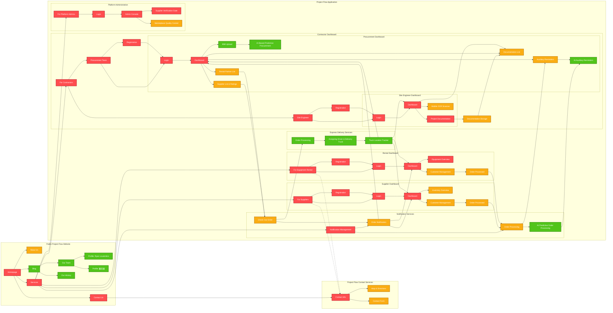

# Project Flow
Software Engineering in Construction Management

## Student Information
| Name | Student ID |
|------|-------------|
| Ryan Lourentino A. | M11505803 |
| 羅奕展 | M11505505 |


## Run the app

Requires Docker Desktop.

```bash
git clone https://github.com/ryanlourentino/project-flow.git
cd project-flow
cp .env.example .env        # Windows PowerShell: copy .env.example .env
docker compose up --build
```

Open http://localhost:3000 and log in with one of the demo accounts below. The first start builds the database:
`db/init/01_etl.sql` loads the TSV files from `db/data`, then the numbered files `02` to `10` add the web app's tables
and demo data, in order (this takes a little while). Reset the database with `docker compose down -v`.
MySQL is also reachable from a database tool at `127.0.0.1:3307` (user and password from `.env`).

## Project structure

```
app.js            Express entry point (middleware and routers)
config.js         Settings read from .env
db.js             Shared MySQL connection pool
routes/           One router per feature
middleware/       Shared checks (login, roles)
views/            Handlebars layouts, partials and pages
public/           CSS, JS, uploaded photos
db/               TSV source data and numbered SQL init files
docs/             ERDs, changelog, team workflow (CONTRIBUTING.md)
```
## Features (Assignment #4: CRUD with HTMX)

Every page that changes data uses HTMX: the server sends back only the changed part of the page, so nothing reloads.

| Feature | Who | Page | Create | Read | Update | Delete |
|---|---|---|---|---|---|---|
| Categories | Admin manages, everyone browses | `/categories`, `/categories/manage` | Add category | Cards with search, products per category | Rename, description | Only when the category has no products |
| Listings (My Products) | Supplier, Rental | `/listings` | Pick category and product (or add a new product, marked "New" until the Admin reviews it), set price, stock, minimum order, lead time | Own listings with search and pages | Price, stock, terms, description | With confirm |
| Cart | Contractor | `/cart` | "Add to cart" on a product's offers page | Grouped by seller, with totals | Quantity (checked against stock and minimum order) | One line or all |
| Projects | Contractor | `/projects` | Name, site address, phase | In construction order | Name, address, phase | Not while documents belong to it |
| Admin: Suppliers | Admin | `/admin/suppliers` | - | Filter (waiting for review, approved, not reviewed, rejected), search, pages | Approve a legit company (certificate optional), Reject with a reason (hides the supplier's products from buyers), Undo | - |
| Admin: All listings | Admin | `/admin/listings` | - | Every listing, newest first, search, pages; odd prices marked | - | Remove a listing that breaks the rules (the seller is notified) |
| Admin: New products | Admin | `/admin/products` | (sellers add them in My Products) | Products waiting for review | Approve, edit name / unit / category, merge a duplicate into an existing product | Remove the product and its listings |

Buyers compare offers on `/categories/<id>` (lowest price per product) and `/items/<id>` (every seller, cheapest first).
Every change is checked on the server: required fields, number ranges, and that users only change their own data.

## Demo accounts

Every company in the ETL data has an account. Passwords are placeholders for testing only:
the ETL sets each password to `changeme-<company id>`, stored as a SHA-256 hash.

| Account type | What it can do | Username | Password |
|---|---|---|---|
| Admin | Manage: categories, supplier verification, all listings, review of new products | `admin` | `admin1234` |
| Supplier | My Products: list materials with own price and stock; browse and compare offers | `superior_foundations_99_28001683` | `changeme-28001683` |
| Rental | My Products: list rentable equipment; browse and compare offers | `atlas_foundations_51794209` | `changeme-51794209` |
| Contractor | Compare offers, Cart, Projects | `central_hardware_03028108` | `changeme-03028108` |

To find another account of a type:

    docker compose exec db mysql -uroot -prootpassword projectflow -e "SELECT username, source_company_id FROM Users WHERE account_type='Supplier' LIMIT 5;"

Its password is `changeme-` followed by its `source_company_id`.

## Priority Legend

| Priority | Color | Description |
|---|---|---|
|  High | Red | Core functions that should be implemented first |
|  Medium | Yellow | Important functions implemented after the core functions |
|  Low | Green | Lower-priority and future enhancement functions |


